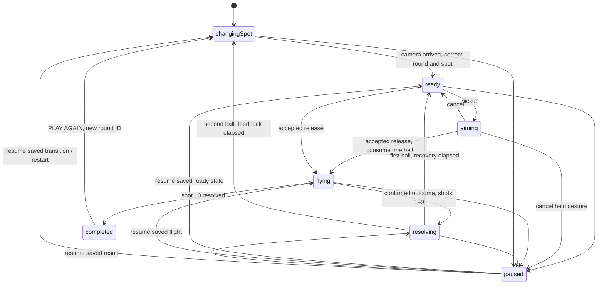

# Five Spot Challenge — implementation and acceptance

Date: 2026-10-20. Branch: `feat/3d-basketball-prototype`.

Actual starting HEAD was `665b2fd6510abddb57b9f8aad8b1683d0feacbe7`, newer than the requested review baseline. This milestone supersedes Endless: ten resolved shots, two per position, no timer or three-miss ending. Original Phaser files are untouched.

## Play

Run `npm run dev` inside `prototype-3d/`, then open [Five Spot Challenge](http://localhost:5174/) or [Unlimited Practice](http://localhost:5174/?mode=practice). Challenge starts immediately. Swipe upward from the active foreground ball; the dimmer ball to its right is decorative. A short swipe can hit the front rim, a longer one can reach the board. The familiar forgiving band and horizontal dead zone are unchanged.

Shoot twice at each position. The camera waits for the second outcome plus 450 ms of feedback, then travels around the fixed basket in 650 ms. Input resumes only after it arrives. Normal same-position recovery keeps the existing 350 ms make / 150 ms miss delays. All ten shots count; only confirmed downward physical passage earns one point. PLAY AGAIN resets the ten outcomes and moves back to the first corner in up to 800 ms. Practice is available beneath the title and on results. Best is saved only on completed challenge rounds, under a separate ten-shot key; blocked storage falls back to page memory.

## Geometry and camera

Central configuration: `src/domain/spots.ts`. Radius/order are data, not duplicated in UI or physics. Exactly five unique positions and two balls each are enforced.

Let the fixed hoop centre be H=(0,3.05,0), radius r=4.2 m, angle θ∈{0°,45°,90°,135°,180°}. Origin:

`O = (H.x − r cosθ, 1.35, H.z + r sinθ)`.

The corner origins are beside the hoop on the baseline, 4.2 m away, rather than beneath or behind the board. Camera radius is r+2.2=6.4 m, height 2.05 m; it looks at (0,2.35,0). Perspective FOV remains 54°. Practice retains its old frontal origin and camera.

| Spot           |    θ | Ball x,z (m)  | Camera x,z (m) | Screen-right x,z |
| -------------- | ---: | ------------- | -------------- | ---------------- |
| LEFT CORNER    |   0° | −4.200, 0     | −6.400, 0      | 0, 1             |
| LEFT WING      |  45° | −2.970, 2.970 | −4.525, 4.525  | .707, .707       |
| TOP OF THE KEY |  90° | 0, 4.200      | 0, 6.400       | 1, 0             |
| RIGHT WING     | 135° | 2.970, 2.970  | 4.525, 4.525   | .707, −.707      |
| RIGHT CORNER   | 180° | 4.200, 0      | 6.400, 0       | 0, −1            |

Camera position follows an angular arc with smoothstep `t²(3−2t)`, avoiding a straight chord through the court. It stays fixed during physical flight and brief result feedback. Pausing suspends both transition progress and simulation. The Canvas and Rapier world persist between spots and retries; individual ball components reset only with a new round. Ball pickup centre and radius are projected from the current camera every frame. Each released ball retains the origin/basis captured on launch.

For right R=(sinθ,0,cosθ), forward F=(cosθ,0,−sinθ), the unchanged gesture response produces lateral offset a and depth d. Target is `H + R·a − F·d`. The ballistic solver solves from O to that target through the unchanged apex. Live preview and release call the same function with the same origin/basis. Rapier receives linear/angular velocity once at release and owns flight and collisions thereafter. No steering or outcome injection exists.

## Spin decision

The angular axis now follows actual horizontal launch velocity: `ω = (−v.z,0,v.x) / hypot(v.x,v.z) × (−7)`.

This axis is perpendicular to travel, including aimed diagonal launches, and has magnitude 7 rad/s. The existing negative sign is deliberately retained: despite the setting's `backspin` name it gives the previously documented forward-spin sense for the frontal shot. Correcting that sign is outside this milestone. Neutral frontal launch velocity and angular velocity match the historical accepted shot exactly. No gravity, dimensions, power response, friction, restitution, or physical scoring rule changed.

Side shots necessarily rotate the old fixed-X axis. [Actual Rapier comparison](verification/five-spot-2026-10-20/spin-comparison.json) records both axes under identical launches at every position, using explicit rim and board contact fixtures. It includes contact impulses and physical positions 250 ms after contact, rather than asserting that rebound behaviour is unchanged. The frontal neutral rim fixture has zero position difference; side/aimed rebound differences are expected and measured. The measured rim-fixture position differences at 250 ms are 8.18 cm (left corner), 3.11 cm (left wing), 0 (top), 1.79 cm (right wing), and 8.18 cm (right corner). Board fixtures range from 0.12 to 6.60 cm. These values describe these explicit inputs, not every possible rebound. All five neutral swipes make with real descending passage. Fixed collision fixtures test real rim and board rebounds at all five positions; ascending-only passage cannot score.

## Round state and lifecycle

`domain/round.ts` is pure. It stores round ID, spot/ball index, attempts, makes, ten outcomes, active shot ID, phase and final score. The store adds progress persistence and shared Practice access. A result is accepted only in `flying`, once, with matching round and current shot IDs. Camera arrival also validates round/spot/phase. Completed rounds reject shots and events. Restart creates a new ID and clears every outcome, active result, flight, trail, net effect and audio voice.

The existing ball lifecycle now supports explicit preparation after a camera gate. It retains at most three ball bodies; old balls can rebound briefly but cannot collide with another ball or score a future shot. The ten-ball rack is not a ten-body simulation: one decorative stand and one dimmer non-physical standby mesh accompany the current real ball. Flight/origin maps are pruned with the body pool, including preparation-driven pruning.

## Presentation and preserved behaviour

The HUD now shows score /10, shot /10, spot, ball 1/2 and five outcome pairs. Current uses an amber ring/dot, made uses a teal check, missed uses a dashed ring/cross, waiting uses an empty ring. Short feedback stays outside the central flight corridor. Results repeat the five pairs, final score, personal best and prominent PLAY AGAIN. There are no new menus, timed mechanics or progression systems.

All existing image-derived materials, net motion and event-driven audio remain in use. Ball/rim/board physical dimensions are unchanged. All five views were inspected for edge-on board thickness, hollow rim, net sorting, ball surface, floor, fence and lighting. The diagonal left view exposed the old decorative pole through the net: it was moved to x=1.4 m, still behind the board, with a small cantilever arm. Neither part has a collider. The retained before frame is [initial left wing](verification/five-spot-2026-10-20/initial/spot-1.png). No elaborate environment was added.

No new image, sound or third-party assets, packages or copied reference code. Existing provenance remains in [licenses](licenses.md).

## Reference study

Studied `thaslle/basketball` on its actual default branch `master`, pinned at `7b0c302482db574bece0ac55ea2ba71063edbcfd`:

- [Ball rack and camera follow](https://github.com/thaslle/basketball/blob/7b0c302482db574bece0ac55ea2ba71063edbcfd/src/components/ball-rack/index.tsx)
- [Rack positions](https://github.com/thaslle/basketball/blob/7b0c302482db574bece0ac55ea2ba71063edbcfd/src/components/ball-rack/rack/positions.ts)
- [Stage camera target](https://github.com/thaslle/basketball/blob/7b0c302482db574bece0ac55ea2ba71063edbcfd/src/components/experience/stage.tsx)
- [Shooting store](https://github.com/thaslle/basketball/blob/7b0c302482db574bece0ac55ea2ba71063edbcfd/src/store/use-shooting-store.ts)
- [Configuration](https://github.com/thaslle/basketball/blob/7b0c302482db574bece0ac55ea2ba71063edbcfd/src/lib/config.ts)

The useful spatial idea is radial rack origins plus a camera behind the active rack aimed at a fixed ring. Its centre-out rack order, timer, large ball array and launch handling were not adopted. This implementation uses original configuration, a bounded body lifecycle, pure round logic and native touch controls adapted to the existing prototype.

## Evidence and verification

See [interactive media review](verification/five-spot-2026-10-20/review.html), [full native-touch ten-shot recording](verification/five-spot-2026-10-20/final/complete-run.webm), [results and retry recording](verification/five-spot-2026-10-20/final/results-retry.webm), and [launch vectors / real outcomes / camera states](verification/five-spot-2026-10-20/final/run-trace.json). The recording script copies actual master audio output; it never writes scores, body transforms, clocks or run state. Its source manifest hashes every runtime file. Native compositor timestamps preserve the actual gameplay timeline at 25 encoded fps. Chrome's oversized surface is cropped only at unused right/bottom margins to the complete, unscaled 400×712 CSS viewport; the game itself is never cropped or time-scaled. Frames are encoded after touch input stops, so encoder backpressure cannot shorten the recording.

Five final camera screenshots: [left corner](verification/five-spot-2026-10-20/final/spot-0.png), [left wing](verification/five-spot-2026-10-20/final/spot-1.png), [top](verification/five-spot-2026-10-20/final/spot-2.png), [right wing](verification/five-spot-2026-10-20/final/spot-3.png), [right corner](verification/five-spot-2026-10-20/final/spot-4.png). [Camera in motion](verification/five-spot-2026-10-20/final/camera-transition.png). Three-size ready/result/retry frames and traces live in [browser evidence](verification/five-spot-2026-10-20/browser/).

Final verification: **62/62 unit and actual-Rapier tests**, **33/33 browser cases** (zero skipped/flaky), and **106/106 original Phaser tests** pass. ESLint, TypeScript/production build and packed-art reproducibility pass. [Unit log](verification/five-spot-2026-10-20/checks/unit.log), [browser log](verification/five-spot-2026-10-20/checks/browser.log), [structured browser results](verification/five-spot-2026-10-20/checks/browser-results.json), [Phaser log](verification/five-spot-2026-10-20/checks/phaser-unit.log), [lint](verification/five-spot-2026-10-20/checks/lint.log), [build](verification/five-spot-2026-10-20/checks/build.log), [art](verification/five-spot-2026-10-20/checks/assets.log).

The final recording contains **48.12 seconds**, **2,142 observed native frames** sampled into 1,203 encoded frames at 25 fps, with the original compositor timestamps. Results/retry is 8.20 seconds; both videos decode at 400×712 with matching audio/video duration and no browser media errors. [Media check](verification/five-spot-2026-10-20/checks/media.json). Native PLAY AGAIN returns to ready in 1,098 ms on this recording host (including the configured 800 ms orbit, UI work and input/poll overhead). This is an observation, not a device performance promise. The recorded run peaked at two ball bodies and five world bodies; separate two-round and 30-shot tests enforce the maximum-three-ball resource budget. [Recording summary](verification/five-spot-2026-10-20/checks/recording-summary.json).

The initial full browser run found two test-only feedback-window assumptions; the complete corrected rerun passes. [Details](verification.md). Runtime source hashes match the final footage. Historical verification images remain unchanged; current Practice regression captures are stored under this milestone's `regression/` folder.

Verification results are recorded in [checks](verification/five-spot-2026-10-20/checks/). Test coverage includes all five origins, camera headings and local aim directions, two balls per spot, ten-shot completion, duplicate/stale results, completion gates, three initial misses without ending, pause/restart during a transition, no held release after transition, accurate post-transition pickup, preview/release equality, best storage validation/fallback, Practice's unlimited 30-shot regression, two complete challenge rounds with bounded bodies/textures/geometries and unchanged art uploads, production native-touch completion, plus the retained audio/net, resize, pointer cancellation, context-loss and original Phaser regressions.

## Files and remaining limits

The exact added/modified/deleted path list is [delivery-files.txt](verification/five-spot-2026-10-20/delivery-files.txt), relative to the checked starting HEAD.

Runtime changes are confined to `prototype-3d/src/`: new `domain/spots.ts`, `domain/round.ts`, `scene/SpotRack.tsx`, `ui/ChallengeHud.tsx`, `ui/HudParts.tsx`; updated `App.tsx`, `store.ts`, `domain/{launch,playerProgress,practice,shot,shotVisuals}.ts`, `input/useShotInput.ts`, `debug/sessionLog.ts`, `scene/{Ball,CameraRig,Court,PracticeScene,ShotPaths}.tsx`, and `ui/{PracticeHud,PauseOverlay}.tsx`, `ui/styles.css`.

Tests: replace obsolete Endless rule/browser cases with `round.test.ts`, `playerProgress.test.ts`, `spotsPhysics.test.ts`, `spinComparison.test.ts` and `browser/challenge.spec.ts`. Recording: `scripts/capture-five-spot.mjs` replaces the obsolete Endless capture command, using `scripts/lib/viewport-recorder.mjs` for calibrated full-viewport recording. Documentation: this report, README, verification index and the dated screenshots/videos/traces/checks.

Remaining: physical iPhone/Android playtesting, device frame rate/thermal checks and human judgement of five-angle comfort, difficulty, feedback and replay appeal. Desktop native-touch emulation cannot establish a human make rate. Corner boards are naturally edge-on; old physical rebounds can briefly enter another view. The illustrated net and reconstructed ball surface retain prior limitations. The legacy spin-sign discrepancy remains explicitly unresolved. The existing large JavaScript bundle warning remains. No additional mechanics are planned in this milestone.
